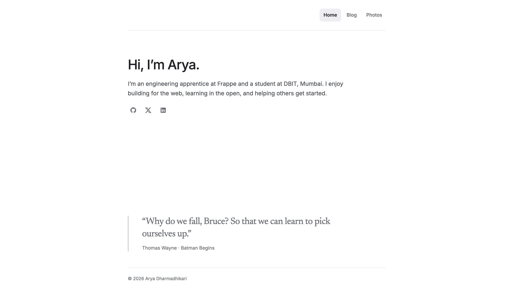
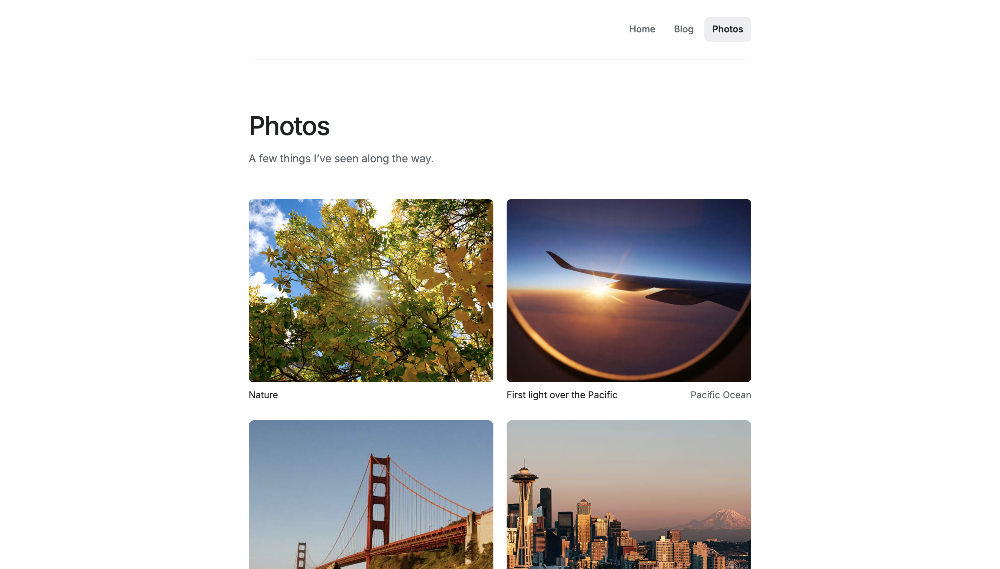

# Arya's Personal Website

A minimal, white personal website built as the Experiment 10 continuation of Practical 9. It has a home page, a writing page, a photo gallery, and forms that save posts and photo records to MongoDB through an Express API.

## Screenshots

### Home

### Blog

### Photos

## Requirements

- Node.js 20 or newer and npm
- MongoDB Community Server running locally, or a MongoDB connection string

## Run the project

1. In the project folder, install dependencies: `npm install`.
2. Copy `server/.env.example` to `server/.env` and adjust `MONGODB_URI` if needed. Set `CLIENT_ORIGIN` only if the frontend uses a different origin.
3. Start MongoDB in a separate terminal. On this Mac with Homebrew, run `mkdir -p server/data/mongodb && /opt/homebrew/opt/mongodb-community/bin/mongod --dbpath server/data/mongodb --bind_ip 127.0.0.1 --port 27018`. Keep this terminal open while using the site.
4. Run both applications: `npm run dev`.
5. Open `http://localhost:5173`. The API runs at `http://localhost:5050`.

The Blog and Photos pages show an empty state until you add content. They show a connection message if the API is unavailable. Creating or persisting records requires the MongoDB service and Express API to be running.

## Personalize

- Update the name and social links in `client/src/data.js`, and edit the introduction and projects in `client/src/pages/Home.jsx`.
- Add photos from the Photos page using an image URL. This practical stores image addresses in MongoDB; it does not upload files to a storage service.

## API

| Method | Endpoint | Purpose |
| --- | --- | --- |
| GET | `/api/health` | Check API and MongoDB connection status |
| GET | `/api/posts` | Retrieve blog posts |
| POST | `/api/posts` | Validate and save a blog post |
| GET | `/api/photos` | Retrieve photo records |
| POST | `/api/photos` | Validate and save a photo record |

All create endpoints return `201 Created` on success and `400 Bad Request` for invalid records. CORS allows the configured Vite origin.

This is a local practical project. The writing and photo forms have no sign-in or access control; add authentication before exposing the API to other users.
