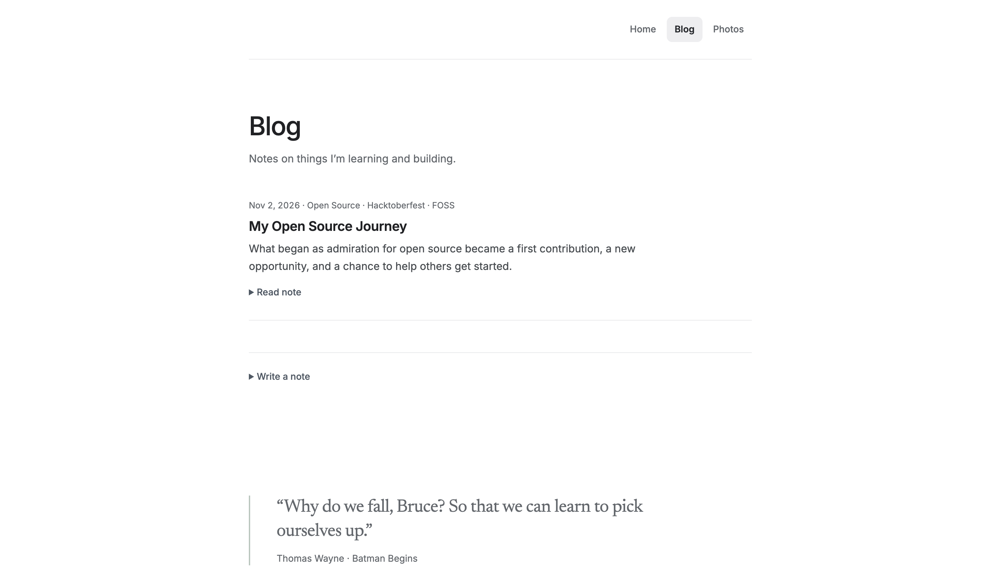

# Arya's Personal Website

A minimal personal website built with React and Vite. It has a home page, a blog, and a photo gallery. Blog entries and photo metadata live in the repository and are bundled into the site during its build.

## Screenshots

### Home

### Blog

### Photos

## Requirements

- Node.js 20 or newer and npm

## Run locally

1. Install dependencies with `npm install`.
2. Start the site with `npm run dev`.
3. Open the local URL printed by Vite, usually `http://localhost:5173`.

Create a production build with `npm run build`. Preview it locally with `npm run preview`.

## Add content

- Add blog entries to `src/content/posts.js`. Each entry can include `slug`, `date`, `title`, `excerpt`, `body`, and `tags`.
- Put photo files in `public/photos/` and add their `src`, `title`, and optional `location` to `src/content/photos.js`. Use paths such as `/photos/coast.jpg` for `src`.
- Rebuild and redeploy after editing content.

Update the profile links in `src/data.js`; edit the introduction and other home page content in `src/pages/Home.jsx`.
